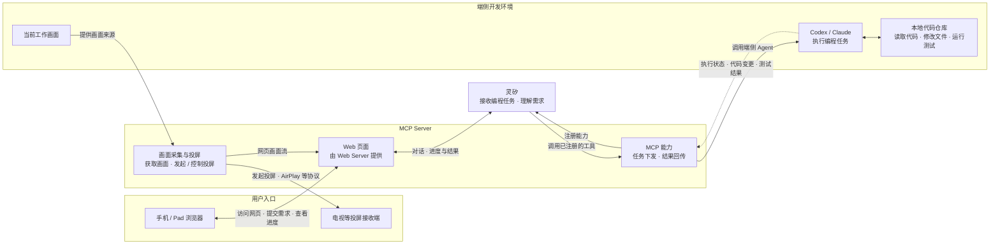

# speak2code

一个探索“用自然语言驱动本地编码 Agent”的产品原型。

MCP Server 向灵矽注册编程工具能力，同时通过 Web Server 提供手机 / Pad 可访问的网页。用户在网页上以语音或文字与灵矽交互；灵矽理解和编排需求，调用 MCP Server 的能力将任务交给端侧 Codex / Claude。端侧 Agent 在本地工作区中读取代码、修改文件并运行测试，执行状态和代码差异经灵矽返回网页供用户确认。

规划中的实时画面链路由 MCP Server 获取当前工作画面，并负责发现接收端、发起和控制向外投屏（如使用 AirPlay 等兼容协议）；手机 / Pad 也可在网页中观看画面，同时与灵矽交互。网页观看不依赖 AirPlay 接收能力。

> 当前仓库是概念验证阶段：已有可交互的前端演示和系统架构设计，尚未接入真实的灵矽服务、MCP Server 或本地编码 Agent。

## 体验原型

原型是一个无需构建的静态 HTML 页面，可以直接在浏览器中打开：

```bash
open prototypes/index.html
```

也可以在 VS Code 中打开 `prototypes/index.html`，使用浏览器预览扩展运行。

### 演示流程

1. 点击“演示任务”，自动填入一条示例需求。
2. 观察灵矽解析需求、端侧 Agent 编码和验证状态的模拟进度。
3. 对比“原始代码”和“修改后”代码中的差异。
4. 点击 `Merge`，查看合并完成状态。
5. 点击麦克风按钮，可以体验浏览器录音和语音识别；浏览器需要授予麦克风权限。

演示任务会模拟给提交按钮增加 `loading` 状态、提交时禁用按钮并显示“提交中…”。整个过程只修改页面内存中的状态，不会修改真实仓库文件。

## 系统架构



各层职责如下：

| 层级 | 职责 |
| --- | --- |
| 用户入口 | 手机 / Pad 浏览器打开 MCP Server 的 Web Server 提供的网页，在页面上与灵矽交互、查看结果与实时画面；兼容的电视等设备可接收投屏 |
| 灵矽 | 识别用户意图，补充任务上下文，编排一次完整的编程任务 |
| MCP Server | 向灵矽注册工具能力并接受调用；通过 Web Server 提供手机 / Pad 网页；获取当前工作画面并负责发现接收端、发起和控制向外投屏，也可供网页观看 |
| 端侧 Agent | 在用户授权的本地仓库中读取、编辑代码并执行验证 |
| 本地工作区 | 保存真实代码、变更和测试结果；未经确认不应直接合并变更 |

完整架构说明见 [design/architecture.md](design/architecture.md)。

## 目录结构

```text
.
├── design/
│   └── architecture.md   # 系统角色与数据流设计
├── drafts/                # 设计草稿，当前为空
├── prototypes/
│   └── index.html         # 可直接打开的交互原型
└── README.md
```

## 当前能力与边界

### 已有能力

- 文字需求输入和演示任务填充。
- 浏览器录音、录音回放，以及浏览器原生语音识别（具体支持取决于浏览器）。
- Codex / Claude 的端侧 Agent 选择交互。
- 任务接收、编码、验证、等待合并、已合并的状态时间线。
- 原始代码与修改后代码的差异展示。
- 重置任务、合并确认和基础键盘可访问性支持。

### 尚未实现

- 灵矽后端连接和真实会话管理。
- MCP Server 的能力注册、网页托管、页面与灵矽的交互、任务协议、鉴权和断线重试。
- MCP Server 获取当前工作画面、发现接收端、发起和控制 AirPlay 等兼容协议投屏及网页观看；包括采集授权和观看权限控制。
- Codex / Claude 的真实调用，以及本地工作区权限控制。
- 真实文件变更、补丁审查、测试执行和 Git 分支 / 合并操作。
- 任务持久化、历史记录、多人协作和生产环境部署。

页面顶部的“未连接服务”、响应中的“模拟响应”和验证结果中的“非真实测试”是当前原型状态的明确提示。

## 后续演进建议

建议按以下顺序推进，以便先验证主链路，再逐步增加安全边界：

1. 固化任务协议：定义需求、工作区、Agent、进度事件、补丁和验证结果的数据结构。
2. 实现 MCP Server 的能力注册、网页访问和任务通道：先支持单任务、单工作区和可追踪的任务 ID。
3. 接入端侧执行器：将 Agent 操作限制在明确授权的工作区，并记录命令、文件变更和退出状态。
4. 替换原型模拟状态：使用服务端事件流或 WebSocket 推送真实进度和差异。
5. 增加确认与回滚：合并前展示补丁和测试结果，失败时保留日志并支持恢复。
6. 补充端到端测试：覆盖语音输入、任务取消、断线重连、权限拒绝和合并失败等路径。

## 开发约定

当前没有包管理器、构建工具或自动化测试配置。修改原型后，可直接刷新浏览器验证；涉及真实服务接入时，再根据最终技术选型补充前后端工程化配置和 CI。
