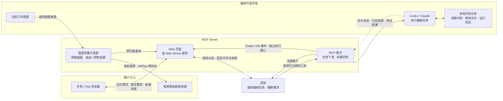

# speak2code

一个探索“用自然语言驱动本地编码 Agent”的产品原型。

MCP Server 向灵矽注册编程工具能力，同时通过 Web Server 提供手机 / Pad 可访问的网页。用户在网页上与灵矽交互；灵矽理解和编排需求，调用 MCP Server 的能力将任务交给端侧 Codex / Claude。灵矽对话区域只显示其 TTS 返回的语音对应文字，并播放下行语音；Codex 执行消息、Git 状态、diff 和 PR 由 MCP Server 推送到独立执行窗口。

> 当前仓库提供一个可运行的 Go MCP Server MVP。灵矽、Codex CLI 和 GitHub 通过 `config.yaml` 配置；未配置真实凭据时仍可启动页面进行本地联调。

## 运行 MCP Server

### 1. 准备环境

需要安装：

- Go 1.25 或更高版本。
- Codex CLI，并确保 `codex` 命令可以在终端中执行。仅启动网页和 MCP Server 时可以暂不安装 Codex；真正执行编码任务时必须安装。
- 如果需要创建 Pull Request，需要可访问目标仓库的 GitHub Token。

在项目根目录执行依赖下载和测试：

```bash
go mod download
go test ./...
```

### 2. 配置服务

项目根目录已经提供 [config.yaml](config.yaml) 示例。服务端默认使用 `frontend` 目录中的实际工作台页面；`prototypes` 目录只用于设计和交互演示，不会被 MCP Server 作为生产页面托管。直接本地联调时可以保留默认配置；需要连接灵矽、调用 Codex 或创建 GitHub PR 时，填写对应字段：

```yaml
server:
    address: ":18080"
    ui_path: frontend
    workspace: . # 必须是 Git 仓库目录
lingxi:
    url: "wss://xrobo-io.qiniuapi.com/v1/ws/"
    token: "灵矽分配的设备令牌"
    device_id: "设备 ID"
    client_id: "客户端 ID"
codex:
    command: codex
github:
    token: "GitHub Token"
    owner: "仓库所有者"
    repo: "仓库名称"
```

`lingxi.url` 为空时，服务仍会启动 Web Server，但不会主动连接灵矽。GitHub 的 `token`、`owner` 和 `repo` 必须同时填写，服务才会启用提交、push 和创建 PR 流程。配置文件中的 `workspace` 是 Codex 读写代码和执行 Git 操作的本地工作区，必须指向一个已经初始化的 Git 仓库，例如 `/Users/rigensen/workspace/aicoding`。服务启动时会提前校验该目录；不能填写仓库的父目录 `/Users/rigensen/workspace`。

### 3. 启动服务

Codex 使用 `--sandbox workspace-write` 在配置的工作区内写入代码，不关闭沙箱。收集 diff 前使用 `git add -N -- .` 标记新文件，确保新建文件也能显示在工作台中；该操作不提交代码，但会改变 Git 索引的 intent-to-add 状态。

使用默认配置文件启动：

```bash
go run ./cmd/speak2code ./config.yaml
```

也可以省略配置文件参数，程序会读取当前目录下的 `config.yaml`：

```bash
go run ./cmd/speak2code
```

如果使用其他配置文件：

```bash
go run ./cmd/speak2code /path/to/my-config.yaml
```

启动成功后，默认地址为 `http://localhost:18080`。可以用以下命令检查服务：

```bash
curl http://localhost:18080/healthz
```

返回 `ok` 表示 HTTP 服务已启动。浏览器打开 `http://localhost:18080` 即可访问前端页面；MCP Server 提供的浏览器通道为 `/ws/ui`，灵矽 MCP 通道为 `/ws/lingxi`。

### 4. 连接灵矽并执行任务

填写 `lingxi.url`、`token`、`device_id` 和 `client_id` 后重启服务。MCP Server 会主动通过 WSS 连接灵矽，发送客户端 `hello`，等待并校验服务端 `hello`，然后注册 `self.code.request` 工具；连接断开时按照 `handshake_timeout`、`reconnect_delay` 和 `max_reconnects` 尝试重连。

填写 Codex 和 GitHub 配置后，任务流程为：灵矽通过 MCP `tools/call` 发送编码需求，服务端调用 `codex exec --json`，逐行读取 JSON 输出并把事件实时推送到浏览器；任务完成后读取工作区 diff，创建 `lingxi/<task-id>` 分支并提交，随后 push 到远端并调用 GitHub API 创建 PR。空白编码需求会被忽略，不会启动 Codex，也不会执行 `git diff`。

如果只想验证页面，不需要填写灵矽、Codex 或 GitHub 凭据，直接启动服务即可；页面中的演示任务使用前端模拟数据，不会修改真实仓库。

## 设计原型

`prototypes/index.html` 是独立的设计原型，不属于 MCP Server 的实际运行页面，可以直接在浏览器中打开：

```bash
open prototypes/index.html
```

也可以在 VS Code 中打开 `prototypes/index.html`，使用浏览器预览扩展运行。

### 演示流程

1. 点击“演示任务”，自动填入一条示例需求。
2. 观察灵矽解析需求、端侧 Agent 编码和验证状态的模拟进度。
3. 对比“原始代码”和“修改后”代码中的差异。
4. 点击 `Merge`，查看合并完成状态。
5. 点击麦克风并授权，浏览器直接采集音频并编码为 16kHz 单声道、60ms 裸 Opus 帧，经 MCP Server 发给灵矽；说完静音约 1.5 秒自动结束，也可再次点击结束，最后一帧输出后发送 `listen / stop`。未说话 10 秒或录音满 60 秒同样结束；收到回复时停止采集，避免外放回录。结束的是本轮监听，服务连接保留，下一轮需重新点击麦克风。不经过浏览器语音转写，不需要点击文字发送按钮。需使用支持 WebCodecs Opus 编码的浏览器及 localhost 或 HTTPS。灵矽返回的音频经 `/ws/ui` 送回浏览器外放；仅播放和重播原声，解码失败提示错误，不启动系统朗读。

演示任务会模拟给提交按钮增加 `loading` 状态、提交时禁用按钮并显示“提交中…”。整个过程只修改页面内存中的状态，不会修改真实仓库文件。

## 系统架构



各层职责如下：

| 层级 | 职责 |
| --- | --- |
| 用户入口 | 手机 / Pad 浏览器打开 MCP Server 的 Web Server 提供的网页，在页面上与灵矽交互并查看结果 |
| 灵矽 | 识别用户意图，补充任务上下文，编排一次完整的编程任务 |
| MCP Server | 向灵矽注册工具能力并接受调用；同时通过 Web Server 提供手机 / Pad 网页 |
| 端侧 Agent | 在用户授权的本地仓库中读取、编辑代码并执行验证 |
| 本地工作区 | 保存真实代码、变更和测试结果；未经确认不应直接合并变更 |

完整架构说明见 [docs/design/architecture.md](docs/design/architecture.md)。

工作台点击“执行详情”打开独立窗口，补齐当前对话页面已收到的执行记录；对话页面关闭或刷新后不保留历史。执行窗口不播放语音。主窗口默认启用外放，浏览器可能要求先点击页面或外放开关；声音使用当前设备的默认输出设备。仅播放和重播灵矽原始语音，不调用系统文字朗读；不支持 WebCodecs Opus 或解码失败时显示错误。MCP Server 只向一个对话连接发送音频，新页面连接或开启外放时移交归属，并通知旧页面停止已排队的音源；关闭外放释放归属，不自动恢复其他页面。同源页面另通过 BroadcastChannel 停止本地播放。外放受浏览器权限和设备输出设置限制。

## 目录结构

```text
.
├── docs/
│   ├── design/
│   │   └── architecture.md   # 系统角色与数据流设计
│   └── drafts/                # 设计草稿，当前为空
├── cmd/speak2code/        # Go 服务入口
├── internal/              # 灵矽 MCP、任务、Codex、GitHub 和 Web 服务
├── prototypes/
│   └── index.html         # Web Server 托管的前端页面
├── go.mod
└── README.md
```

## 当前能力与边界

### 已有能力

- 文字需求输入和演示任务填充。
- 浏览器麦克风直接上传裸 Opus 音频，以及灵矽下行语音播放（具体支持取决于浏览器）。
- Codex / Claude 的端侧 Agent 选择交互。
- 任务接收、编码、验证、等待合并、已合并的状态时间线。
- 原始代码与修改后代码的差异展示。
- 重置任务、合并确认和基础键盘可访问性支持。

### 当前限制

- 灵矽连接需要平台分配的设备令牌、设备 ID 和客户端 ID；当前没有自动 OTA 地址发现，但支持按配置参数有限重连。
- Codex 适配器当前调用本机 `codex exec --json` 命令，并解析其逐行 JSON 输出。项目不使用不存在的官方 Go Agents SDK，也不将 Codex CLI 描述成 Agents API。
- GitHub 流程创建分支、提交和 PR，但 Merge 按产品要求只打开 GitHub PR 页面，不自动合并。
- 灵矽连接会验证服务端 hello 响应，并按 YAML 中的重连参数处理断线。
- 麦克风以 `listen / start / manual`、二进制裸 Opus、`listen / stop` 的顺序直接上传音频，不使用 MediaRecorder 容器或浏览器语音识别。手动输入的文字仍可独立发送；只有灵矽通过 MCP 调用编程工具才启动 Codex。下行裸 Opus 使用握手协商采样率解码并排队播放。页面区分灵矽连接状态，网页 WebSocket 断线后自动重连。真实对话仍依赖灵矽连接及智能体绑定配置。
- 工作区授权、任务持久化、多人会话隔离和生产部署仍需继续加固。

页面顶部的“未连接服务”、响应中的“模拟响应”和验证结果中的“非真实测试”是当前原型状态的明确提示。

## 后续演进建议

建议按以下顺序推进，以便先验证主链路，再逐步增加安全边界：

1. 将工作区授权、命令审计和任务取消固化到执行器边界。
2. 增加会话隔离、权限校验和任务持久化。
3. 实现由 MCP Server 负责的真实画面采集、接收端发现和 AirPlay 等投屏协议。
4. 补充端到端测试：覆盖语音输入、断线重连、权限拒绝、Codex 失败和合并失败等路径。

## 开发约定

运行测试和覆盖率：

```bash
go test ./...
go test ./... -coverprofile=coverage.out
go tool cover -func=coverage.out
```
