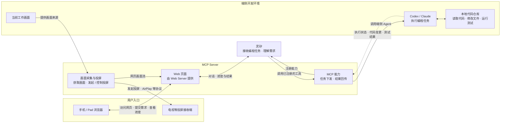

MCP Server 一方面向灵矽注册编程工具能力，供灵矽在任务编排时调用；另一方面通过 Web Server 提供页面，供手机 / Pad 浏览器访问。用户在页面上与灵矽对话，灵矽调用 MCP Server 的能力驱动端侧 Codex / Claude 在本地仓库中读取、编写和测试代码，进度与结果再经灵矽返回页面。

实时画面是独立于任务结果的链路：MCP Server 获取当前工作画面，并负责发现接收端、发起和控制向外投屏（如使用 AirPlay 等兼容协议）。手机 / Pad 也可在 MCP Server 提供的网页中观看画面，并继续通过页面与灵矽交互；网页观看不等于 AirPlay 接收。画面获取和投屏应仅在用户授权后开启，并限制可观看的设备与会话。
