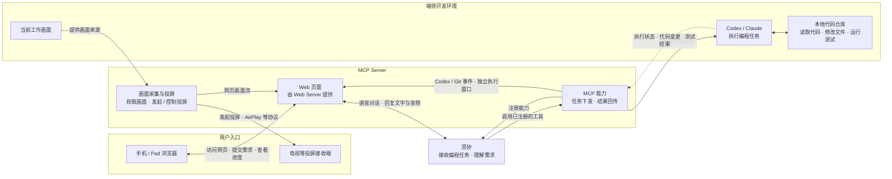

MCP Server 一方面向灵矽注册编程工具能力，供灵矽在任务编排时调用；另一方面通过 Web Server 提供页面，供手机 / Pad 浏览器访问。灵矽对话区仅展示 `tts / sentence_start` 返回的语音对应文字并外放二进制音频，不展示用户 STT、Codex 或 Git 消息。Codex 实际输出的执行消息、Git 阶段、diff 和 PR 直接由 MCP Server 推送到浏览器，独立执行窗口通过同源 opener 消息接收历史及实时事件，不建立重复音频连接。该窗口依赖主窗口存活，不持久化历史；浏览器不支持 WebCodecs 时提示无法解码原声，不另行合成语音。

## 可运行 MVP

Go MCP Server 同时承担三条链路：

1. 作为灵矽设备端，使用 YAML 中的 WSS 地址和 `Authorization`、`Device-Id`、`Client-Id`、`Protocol-Version` 请求头主动连接，发送 `hello` 并声明 MCP 能力；连接建立后等待并校验服务端 hello，断线按配置重连。
2. 处理灵矽封装在 `type: mcp` 中的 JSON-RPC `initialize`、`tools/list` 和 `tools/call`。当前注册的工具是 `self.code.request`。
3. 通过 HTTP 托管 `frontend/index.html`，通过 `/ws/ui` 传输音频、对话请求、连接状态、Codex CLI `--json` 逐行事件、工作区 diff 和 PR 信息。浏览器通过 AudioWorklet 采集 16kHz 单声道 PCM，WebCodecs 编码为 60ms 裸 Opus，MCP Server 同步按序转发 `listen / start / manual`、二进制帧、`listen / stop`，不做浏览器语音转写，也不上传 MediaRecorder 容器块。录音停止时等待编码刷新，网页断线时释放麦克风并结束上游监听。网页请求不直接启动 Codex，只有灵矽的 MCP 工具调用会启动执行。手动文字输入仍独立通过 `listen / detect` 发送。灵矽返回的裸 Opus 经同一 WebSocket 广播，浏览器按握手协商采样率播放；网页断线后自动重连。麦克风需要安全上下文和支持 Opus 的 WebCodecs 编码器，不支持时明确报错。

浏览器每次点击麦克风开启一轮监听：检测到说话后静音约 1.5 秒、一直无输入 10 秒或录音达到 60 秒时结束。收到灵矽回复文字或音频时也停止采集，避免回录；仅结束监听，连接保留，下一轮需重新点击麦克风。静音检测使用音量阈值，噪声环境下仍可手动停止。仅播放或重播灵矽原声，不使用系统文字朗读；解码失败显示错误。重播前停止原有音源。MCP Server 只向一个对话连接发送音频，新页面连接或开启外放时移交归属，并通知旧页面停止已排队的音源；关闭外放释放归属，不自动恢复其他页面。同源标签页另通过 BroadcastChannel 停止本地播放。

`tools/call` 创建非空任务后，Codex 适配器以 `--sandbox workspace-write` 在配置的 Git 仓库工作区运行，服务端使用 `git add -N -- .` 将新文件标记为 intent-to-add 后读取 `git diff`，创建 `lingxi/<task-id>` 分支并提交，再使用 GitHub API 创建 Pull Request。工作区必须是实际项目仓库，不能填写仓库父目录；服务启动时会提前校验。空任务不会进入 Codex 或 `git diff`。浏览器的 Merge 按钮打开 PR 新标签页，不绕过 GitHub 审查直接合并。

实时画面是独立于任务结果的目标链路：MCP Server 应获取当前工作画面，并负责发现接收端、发起和控制向外投屏（如使用 AirPlay 等兼容协议）。当前代码尚未实现真实画面采集、接收端发现、AirPlay 投屏或网页画面流；手机 / Pad 网页目前只展示任务状态和 diff。实现时必须在用户授权后开启，并限制可观看的设备与会话。
