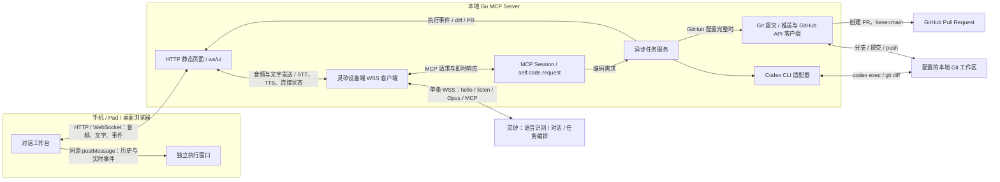

# 当前系统架构

本文描述 Go MVP 的实际实现，不把静态原型或未来能力视为已实现服务。实际工作台位于 [frontend/index.html](../../frontend/index.html)，独立演示位于 [prototypes/index.html](../../prototypes/index.html)。

## 组件与职责

浏览器只连接本地 Web Server，不直接连接灵矽，也不直接调用 MCP 工具。灵矽负责理解需求和编排任务；MCP Server 同时负责提供网页、连接灵矽、响应工具调用和调度本机 Codex。当前没有 Claude 适配器，页面的 Claude 选项禁用。

| 模块 | 当前职责 |
| --- | --- |
| [cmd/speak2code/main.go](../../cmd/speak2code/main.go) | 加载 YAML、校验 Git 工作区、解析页面目录、组装依赖并启动服务 |
| [internal/server/server.go](../../internal/server/server.go) | HTTP 路由、浏览器 WebSocket、事件广播、单页面音频播放归属 |
| [internal/lingxi/client.go](../../internal/lingxi/client.go) | 设备鉴权、hello 协商、语音与 MCP 复用、重连、STT/TTS 分发 |
| [internal/mcp/session.go](../../internal/mcp/session.go) | initialize、tools/list、tools/call |
| [internal/task/service.go](../../internal/task/service.go) | 异步运行 Codex、收集 diff、可选提交及推送、发布事件 |
| [internal/github/client.go](../../internal/github/client.go) | 创建指向 main 的 PR，不执行合并 |

## 接口与连接

| 入口 | 行为 |
| --- | --- |
| `/` | 托管配置的页面目录，默认 frontend |
| `/healthz` | 返回 ok，仅表示 HTTP 可用，不代表灵矽或 Codex 可用 |
| `/ws/ui` | 浏览器对话、音频、播放归属控制和事件通道 |
| `/ws/lingxi` | 入站 WebSocket MCP 通道，处理 MCP 封装消息；不是生产上游语音连接 |

常驻服务主动连接配置的灵矽 WSS 地址，携带 Bearer Token、Device-Id、Client-Id 和 Protocol-Version 请求头。先发送声明 `features.mcp=true` 的 hello，校验服务端 hello 后安装文字与语音发送器，记录协商的下行采样率。音频和 MCP 共用连接，写入通过互斥锁串行化。

默认 hello 超时 10 秒，重连间隔 2 秒，可由 YAML 配置。常驻入口将 `max_reconnects` 设置为 -1，持续重试，不受配置中的累计次数限制；底层客户端仍支持非负次数上限。断线时清除发送器并广播状态。浏览器单独重连自己的 WebSocket，网页连接成功不代表灵矽已连接；上游恢复前禁用麦克风。

## 语音与文字

1. 浏览器通过 AudioWorklet 采集 16kHz 单声道 PCM，用 WebCodecs 编码为 60ms 裸 Opus 帧。需要 localhost 或 HTTPS、麦克风授权和支持 Opus 编码的浏览器。
2. 按序发送 listen/start、二进制帧、listen/stop。服务端补入 session_id 和 manual 模式后转发。停止时等待编码刷新，网页断线释放麦克风并尝试停止上游监听。非活动监听的二进制消息另有兼容音频队列，不是正常页面主链路。
3. 说话后静音约 1.5 秒、无输入 10 秒、录音满 60 秒或收到回复时结束监听，不自动开始下一轮。静音检测是音量阈值，不是语义断句。
4. 灵矽 stt 经 lingxi_input 更新“我的需求”，仅显示，不再次发送文字；更新频率由上游决定，不保证逐字转写。手动点击文字发送时才通过 listen/detect 发送文本。
5. tts/sentence_start 经 lingxi_speech 显示在回复区。下行裸 Opus 按 hello 协商采样率解码并排队播放，不使用浏览器文字朗读兜底，失败明确提示。

默认外放，无外放复选框，浏览器可能要求先点击页面解锁音频。服务端只向一个播放连接发送二进制音频；新连接或 playback/claim 移交归属，向旧连接发送 playback_revoked。断开或 playback/release 释放归属，不自动选择其他页面。同源页面通过 BroadcastChannel 停止已有音源。文本事件仍广播到所有 UI 连接，播放归属不等于用户或任务隔离。

## MCP 与执行

灵矽通过 `type: mcp` 封装的 JSON-RPC 请求完成 initialize 和 tools/list。唯一工具 self.code.request 必需字符串参数 request。响应工具列表即提供能力发现，没有额外主动注册接口；协商日志不代表工具已被调用。

tools/call 校验后按请求 ID 生成任务 ID，异步启动任务，立即返回“编码任务已接收”，不是最终执行结果。当前 diff、错误和 PR 只发布到网页事件通道，没有异步回传灵矽的结果协议。纯空白需求由任务服务忽略，不运行 Codex。

1. 在配置工作区运行 `codex exec --json --sandbox workspace-write --skip-git-repo-check`，逐行解析标准输出并发布事件。失败发布 error 后结束。
2. 执行 `git add -N -- .` 标记新文件，再读取 `git diff -- .` 并发布 diff。操作会改变索引；diff 不是完整快照，不包含已有 staged 变更的完整内容。
3. 未完整配置 GitHub token、owner、repo 时，只发布 ready，不创建分支、不提交、不推送、不创建 PR。
4. GitHub 配置完整时，在同一工作区执行 `git checkout -B lingxi/<task-id>`、`git add -A`、commit、`git push -u origin`，再创建以 main 为目标的 GitHub PR。任一步失败发布 error，不自动回滚。

代码直接修改配置工作区，不使用独立 worktree，也不等待页面确认才提交。提交可能包含用户已有变更。服务展示 Codex 输出，但没有独立测试命令、结构化测试结果校验或运行时覆盖率门禁，不能仅凭状态文案认定项目测试通过。

## 页面与事件

对话主窗口显示用户输入和灵矽回复。执行状态、Codex 输出、Git 阶段、diff、ready、PR 和错误保存在主窗口内存，通过同源 opener/postMessage 发送到 `?view=execution` 窗口。执行窗口不另建音频连接，不播放语音，依赖主窗口存活。

服务端也在内存中记录广播事件，但没有历史查询、重连补发或持久化接口；刷新会丢失页面记录。PR 事件提供 GitHub 链接。当前 Merge 按钮仅更新本地确认状态并提示去 GitHub 合并，不调用合并 API，也不自动打开 PR；确认状态不是服务端任务状态。

## 当前边界

- 启动验证工作区存在且位于 Git 仓库内，没有用户级工作区授权。Codex 使用 workspace-write 沙箱，Git 命令直接在工作区执行。
- HTTP 和 WebSocket 没有用户鉴权，WebSocket 接受任意 Origin，不适合直接暴露到不受信任网络。手机 / Pad 访问需另行配置安全入口、HTTPS 和访问控制。
- 所有页面共享一个上游连接和工作区，没有录音互斥、多人会话隔离、任务串行执行、幂等去重或取消接口，并发任务可能互相影响。
- 日志写入 `/tmp/speak2code.log`，任务需求和命令参数可能入日志，应按敏感数据管理。
- 尚无专用心跳、完整读写超时或优雅退出流程。持续重连仅在检测到断开后生效，不保证半开连接及时恢复。
- 没有画面采集、网页画面流、接收端发现或 AirPlay 实现，已移除工作台投屏入口。未来若恢复，获取画面、发现接收端和控制投屏由 MCP Server 负责，端侧只提供画面来源；必须补齐用户授权、会话隔离与观看权限，网页观看不等于 AirPlay 接收。
